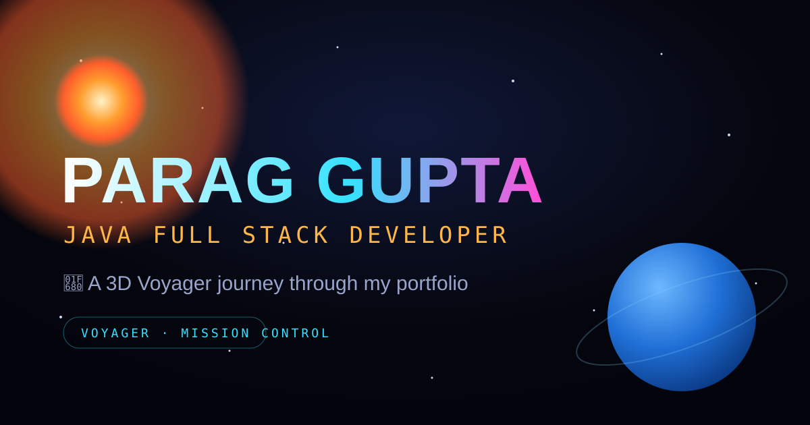

# 🚀 Voyager — Parag Gupta's 3D Solar-System Portfolio

> A portfolio you *fly through*. Launch a rocket, cruise the entire solar system, click planets and galaxies for facts, dive into a black hole, and land on a finale — all in real-time **WebGL**, with **synthesized spatial audio**, and **zero frameworks**.

**Live:** _add your Vercel URL here_ · **Code:** https://github.com/parag-1812/paraggupta.github.io



---

## ✨ The Experience

Scroll = travel. Every section of the portfolio is a stop on a voyage outward from the Sun.

| Stop | Planet | Section |
|------|--------|---------|
| Launch | 🚀 3D rocket blast-off | Intro |
| ☀️ Sun | Hero | Name, role, résumé, contact |
| ☿ Mercury | Briefing | About me |
| ♀ Venus | Onboard Systems | Skills |
| 🌍 Earth | Home Port | Projects |
| ♂ Mars | Flight Log | Experience |
| ♃ Jupiter | Academy | Education |
| ♄ Saturn | Ringed Frontier | Currently exploring |
| ⛢ Uranus | Waypoint | Deep-space breather |
| ♆ Neptune | Open Channel | Contact |
| 🕳️ The Void | Black hole | Dive → Journey's End finale |

### Highlights
- 🌌 **Full solar system** — Sun + all 8 planets with procedural textures, Saturn's rings, orbiting moons, fresnel atmospheres and particle halos.
- 🎥 **Cinematic camera** — smooth scroll-driven fly-through, mouse parallax, banking, velocity FOV kick, hyperspace warp streaks and a filmic vignette.
- 🖱️ **Interactive** — hover + click planets to travel with space facts; fly out to **Andromeda / Triangulum / Whirlpool** galaxies and back.
- 🛸 **Easter eggs** — a clickable **UFO** with an alien transmission, and **click empty space to make a wish** (shooting star + chime).
- 🕳️ **Black-hole dive** — warp tunnel + white-flash → a calm "Journey's End" finale.
- 🔊 **Synthesized audio** — countdown, rocket rumble, ambient space drone, whooshes, an arrival chime and reverb — all generated with the Web Audio API (no files). Mute toggle included.
- ▶️ **Auto-tour** — a hands-free flythrough button (great for recruiters).
- 📱 Responsive + `prefers-reduced-motion` friendly.

---

## 🛠️ Built With

**Vanilla HTML · CSS · JavaScript** + **[Three.js](https://threejs.org/)** (r128, vendored) with UnrealBloom post-processing, and the **Web Audio API** for sound. No build step, no framework, no dependencies to install.

> Portfolio content reflects my work as a **Java Full Stack Developer**: Java, Spring Boot, React.js, REST APIs, microservices, SQL, Docker and more.

---

## 🚀 Run it locally

It's fully static — just open the file, or serve it:

```bash
# clone
git clone https://github.com/parag-1812/paraggupta.github.io.git
cd paraggupta.github.io

# option A: just double-click index.html

# option B: serve (any static server), e.g. Node
npx serve .
# or Python
python -m http.server 8000
```

Then open the printed URL. That's it.

---

## 📁 Structure

```
.
├── index.html          # markup + meta/OG + script order
├── css/style.css       # all styling (space theme, HUD, panels, animations)
├── js/
│   ├── config.js       # ← ALL portfolio content lives here (edit this)
│   ├── audio.js        # Web Audio engine (synthesized sound)
│   ├── scene.js        # the 3D solar system (Three.js)
│   ├── rocket.js       # 3D launch-page rocket
│   ├── main.js         # controller: scroll → camera, HUD, interactions
│   └── vendor/         # Three.js r128 + bloom post-processing (vendored)
└── assets/             # avatar, og-image, résumé link, etc.
```

## ✏️ Editing content

Everything about me — name, roles, skills, projects, experience, links, facts —
lives in **[`js/config.js`](js/config.js)**. Change the text, save, refresh. No
layout knowledge required.

---

## 🗺️ Build log

Shipped in milestones: MVP → 3D solar system → interactivity → galaxies & facts →
black-hole dive → audio & cinematic polish → UFO, auto-tour, wishes & share-ready
polish.

---

Made with ☕ and a lot of `requestAnimationFrame` by **Parag Gupta**.
[GitHub](https://github.com/parag-1812) · [LinkedIn](https://www.linkedin.com/in/paraggupta7023/)
